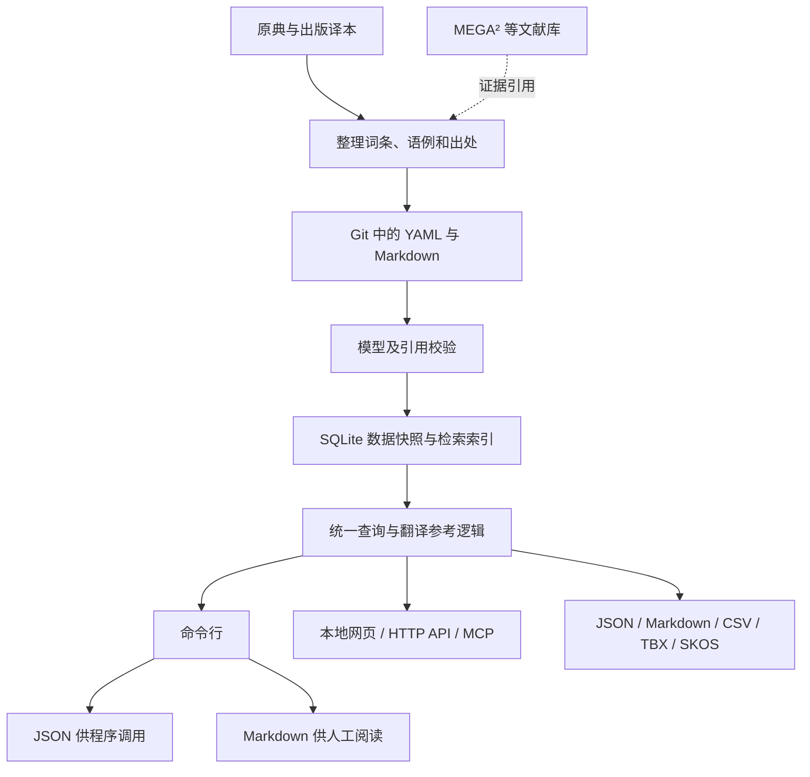
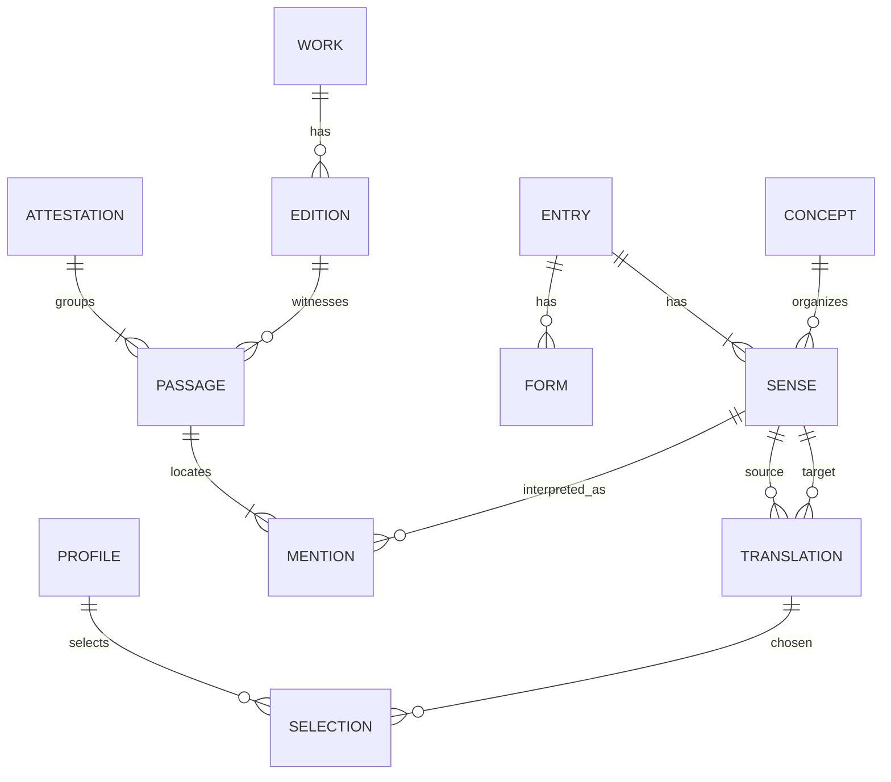

# 架构方案

## 目标与首批范围

同一套有出处的多语数据同时服务于术语查阅、上下文辨析和翻译项目。编辑者能够追溯原词出现和实际译本用词，翻译程序能够按义项、作品、版本及项目方案取得建议。

首批以六组德中英术语验证完整流程，已交付数据模型、工作稿语例、文章、命令行、本地查阅网页、HTTP、MCP 和五种导出格式。数据结构允许扩展语言、作品和研究传统；当前覆盖不代表已建立全面词汇表。

## 数据流与维护边界

YAML 和 Markdown 是编辑来源。SQLite 保存完整结构化快照、文章内容和索引，可独立查询并随时重建。`Editor` 将网页和 MCP 写入统一为批次：在内存中应用全部操作，校验完整 Dataset 与引用后写回涉及的源文件并重建 SQLite。新增记录集中于各类别的 `managed.yaml`，已有记录保留原文件位置。资料只在本地保存，Git 由使用者手动提交推送。

编辑草稿位于 `data/drafts/`，保存尚未完成的操作和导入说明，不进入 Dataset、翻译参考或正式导出。`data/editor-state.yaml` 保存编辑版本，用于阻止陈旧请求覆盖新修改；正式发布另行递增数据补丁版本并更新所有方案的版本固定值。跨进程文件锁串行化保存；`build/editor/transaction.json` 只暂存当前事务涉及文件的旧内容，用于失败回滚或中断恢复，完成后删除，不建立长期备份。

本阶段使用 Python 3.11+、Pydantic 2、PyYAML 和标准库 SQLite／argparse。JSON Schema 从 Pydantic 定义导出。服务逻辑不依赖命令行，也不依赖外部文献服务在线；网页与 MCP 直接调用该模块；可选依赖组保持基础 CLI 安装简洁。

## 词汇、概念和文献证据

词形帮助识别文本，义项表达特定含义，概念组织跨语言查阅。译法关系连接两个语言的具体义项，其适用范围和证据均为独立字段。概念不自动合并同词、近义词或同译词；关系说明保留解释和依据。

语例分别保存每个版本中的短引文和定位。各语种在同组出现只表示它们属于对应候选，不能据此推导逐词等价。段落级对应保存段落 ID，词语级对应还必须显式指定各段落中的术语标注，支持多对多关系。

作品、出版版本和网页载体分别描述：例如《资本论》的德中“第四章第三节”与所用英译本“第六章”独立定位。稿页、书页和网页章节不互相换算。数字转录保留其版本说明及局限，不冒充已逐字核对的纸本或手稿。

出版译本实际用词存于语例；项目采用的译法存于 profile。两者能够独立变化。解释、义项划分和概念关系属于编辑说明；引文本身与这些说明分别存放。

## 检索与翻译流程

人工查询按原词、拼写变体、屈折形式和固定词组匹配，精确结果优先于前缀与子串；随后补充说明和语例中的结果。说明和语例使用 FTS5，中文短词使用字面子串查询，避免依赖 trigram 的三个字符门槛。词形规范化仅作用于检索键，不覆盖存储原词。

翻译准备接受原文、语言方向、profile，以及可选作品、源版本和显式义项。流程为：

1. 识别已登记词形；同一位置优先最长词组，保留相同跨度的同形词条。
2. 按作品筛选义项，按语言和范围整理译法；范围不足时标为 `needs_context`。
3. 将项目选择附在候选上；只有义项唯一、范围已匹配且选择唯一时输出方案建议。
4. 补充命中概念的一层直接辨析关系及依据，保留关系的解释和整理状态。
5. 默认输出去重的精简参考包，保存实际用词、定位和状态；完整短引文、对应关系与书目信息通过 `read_evidence` 按需读取。语义判读仍由使用者结合上下文完成。

明确义项通过 `--sense` 提供。系统不从词频或近似语义强行选定 `Aufhebung` 的含义，不进行通用德文词形分析，也不把未命中理解为不存在术语。

`Lexicon.lookup`、`read_entry`、`read_evidence`、`prepare_translation` 和 `export_glossary` 是各入口共用的业务接口；CLI 将其结果输出为 JSON 或 Markdown。`prepare_translation` 返回候选与方案参考，不承担整段翻译。精简视图的字段和信息保留约定见 [AI 翻译参考](ai-translation.md)。

## 扩展与标准交换

- 收词按作品、版本、时期与语言推进。当前覆盖清单见 `data/coverage.yaml`；后续将覆盖统计接入构建，避免把少量示例描述为全库覆盖。
- MEGA² 外部证据通过 provider、evidence ID 和 version 登记。本轮没有运行期网络适配器，不搬运整部文献库。
- 网页已提供查词、义项辨析、版本对照、概念、来源目录和段落参考；HTTP／MCP 复用业务模块，保持人工与程序结果一致。使用说明见 [网页与 MCP](interfaces.md)。
- TBX-Basic DCA 用于术语交换，SKOS Turtle 用于概念组织；[导出约定](exports.md)明确字段映射与信息损失。当前 JSON Schema 是本项目格式，不宣称符合 TBX 或完整实现 OntoLex。
- 本地编辑服务按需启用，不增加远程账户或部署；独立 SQLite 快照保持只读。编辑模型与正式学术数据模型分开，详情见[编辑指南](editing.md)。

建模参考：[OntoLex-lemon](https://www.w3.org/2016/05/ontolex/) 关于词条、词形和义项的区分；[TBX](https://www.tbxinfo.net/) 关于术语交换；[SKOS](https://www.w3.org/TR/skos-reference/) 关于概念组织。OntoLex-lemon 所引文件为社区规范，SKOS 为 W3C Recommendation。
